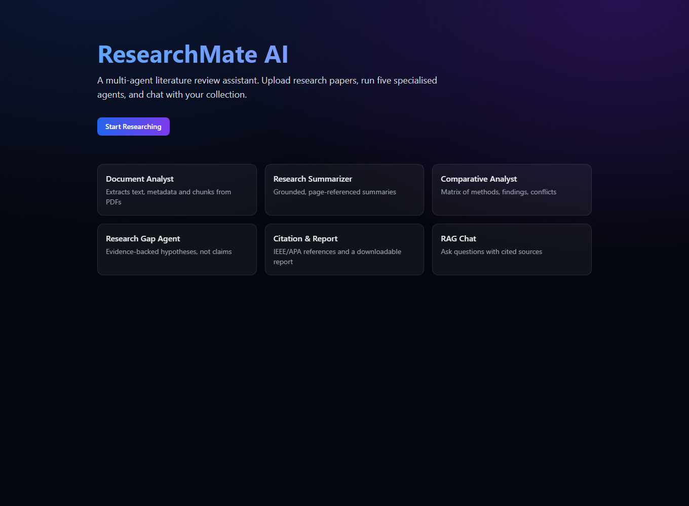
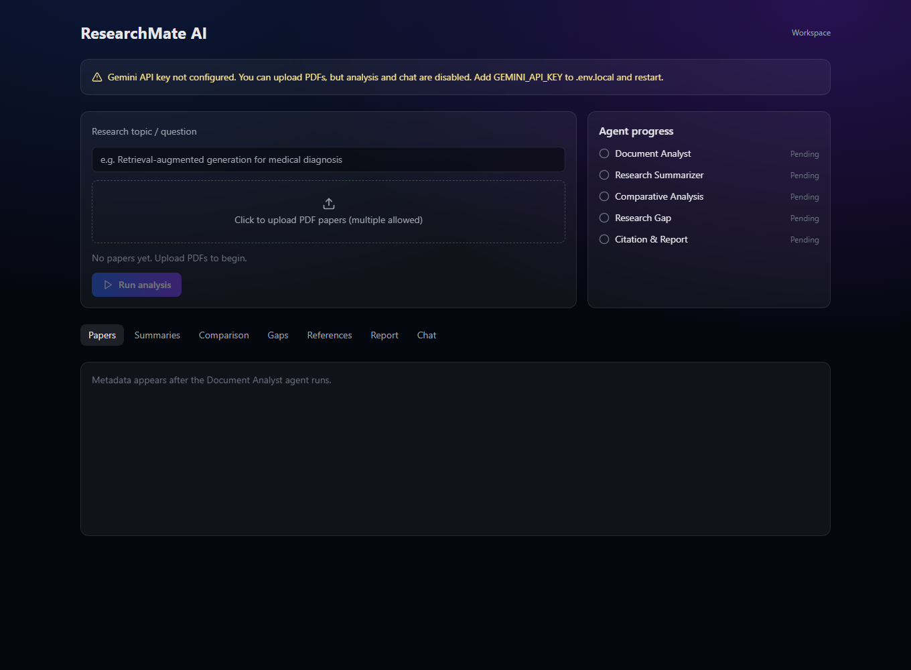

# ResearchMate AI — Project Report

## Overview

ResearchMate AI is a web application for organizing a small collection of research papers and generating a structured, multi-paper literature review. It is built with Next.js and React, and uses Groq-hosted LLMs for document analysis, summaries, comparison, research-gap hypotheses, report writing, and question answering.

## Features implemented

### Research workspace and PDF handling

- Enter and retain a research topic/question in the browser.
- Upload multiple PDF papers into a workspace.
- Extract text page by page and reject files that are not PDFs, have invalid PDF headers, are empty, exceed the configured size limit, duplicate an existing upload, or appear to be scanned/image-only without extractable text.
- Remove an uploaded paper and restart the agent progress for the current collection.
- Defaults are a 15 MB per-file limit and up to 10 papers; both can be configured with environment variables.

### Ordered literature-review agents

The workspace runs the following agents in sequence and displays each agent's pending, running, completed, or failed state. Failed steps can be retried.

1. **Document Analyst** — extracts bibliographic metadata (title, authors, year, abstract, methodology, and conclusions), splits page text into overlapping chunks, and creates embeddings for retrieval.
2. **Research Summarizer** — creates a structured, page-referenced summary for each paper, including objective, methodology, dataset, findings, limitations, and conclusion.
3. **Comparative Analysis** — compares papers' similarities, methodological differences, conflicting results, themes, and trends, and produces a comparison matrix.
4. **Research Gap** — proposes evidence-backed future research directions as hypotheses that require verification, with supporting paper titles.
5. **Citation & Report** — formats IEEE and APA references, writes an executive summary, and assembles a Markdown literature review with paper summaries, comparisons, gaps, limitations, and references.

### Results, export, and chat

- View paper metadata, summaries, comparisons, gaps, references, the generated report, and chat in separate workspace tabs.
- Copy IEEE/APA reference lists and copy the generated report.
- Download the literature review as a Markdown file.
- Ask questions about the uploaded collection. Retrieval selects up to six relevant embedded text chunks; answers are instructed to use only those excerpts and include paper/page citations.

### Evidence and validation safeguards

- Model-generated structured data is validated against Zod schemas, with one retry when the returned JSON is invalid.
- The system instruction treats PDF text as untrusted input and directs the model not to follow instructions found inside papers or invent unsupported details.
- The generated report states that its outputs are AI-generated and should be verified against the source papers.

## Current run and verification

| Check | Result |
|---|---|
| Development server | Running at `http://localhost:3001` (port 3000 was already occupied). |
| Landing page | Served successfully; HTTP 200 and page title `ResearchMate AI`. |
| Workspace page | Served successfully; HTTP 200 and workspace controls rendered. |
| TypeScript check | `npm run typecheck` passed. |
| Groq configuration | Not configured in this run: `GET /api/step` returned `aiConfigured: false`. |
| Analysis and chat | Disabled until a Groq API key is configured. |
| PDF/agent end-to-end run | Not performed: no PDF test input or Groq API key was available. |

To enable analysis and chat, put a Groq API key in `.env.local` as `GROQ_API_KEY=...` and restart the development server. The key is read by server-side code only.

## Operational notes and limitations

- Upload and review state is stored in memory for the running server process; restarting the server clears sessions.
- Scanned/image-only PDFs need OCR before upload; OCR is not built in.
- PDF extraction is text-based, so some figure/table content may be lost. Long paper text is capped for model prompts.
- AI-generated summaries and research-gap hypotheses should be checked against the original papers.

## Screenshots

The following screenshots show the running app as it appeared during this verification. The workspace screenshot includes the current missing-Groq-key notice.

### Landing page

### Research workspace

